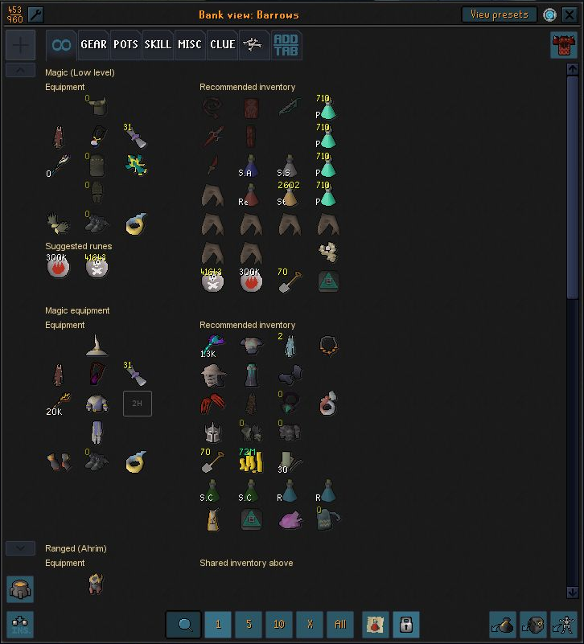

# Improved Banking

Find bank items by name, category or activity. Preview gear and inventory setups, save your own views, and organize items with named, colored groups. Adjust the bank layout, move its controls and capture full-tab screenshots.

**Beta:** categories and activity setups are still being refined. The Wiki-based catalogue is bundled with the plugin and updated through plugin releases; it is not fetched live while you play.

An example Barrows view. Equipment and inventory sections retain item quantities and distinguish missing items from owned alternatives.

## What you can do

- **Find items:** search categories, activities, item uses and saved groups. Optionally add those matches to the bank’s native search.
- **Plan an activity:** open equipment and inventory views with guide context and owned alternatives.
- **Save a personal view:** copy a preset, edit its items and groups, and drag its displayed items into place. Your stored bank order stays unchanged.
- **Mark and label groups:** link markers to items or draw an area, then customize borders, backgrounds and labels.
- **Adjust the bank:** change width, height, columns and tab alignment. Alt-drag controls along the bottom or into a side dock.
- **Capture a bank view:** save the complete current tab or search results with item icons, quantities and a legend.
- **Explore optional GE tools:** search categories and activities, with supported guide tiers, prices, owned-item and requirement information.

## Getting started

1. Install **Improved Banking** from RuneLite’s Plugin Hub.
2. Enable the built-in **Bank Tags** plugin before using preset views. **Bank Tag Layouts** is optional.
3. Open your bank and the square-frame Improved Banking sidebar icon.
4. In **Legend**, search an activity or category and choose **Show in bank**. **Add to Legend** saves its group; **Clear bank filter** returns to ordinary bank contents.
5. Use **Legend → Saved views → Save as custom view** to make an editable copy. Commit editor changes with **Save changes**.

Use **Custom** to create groups and markers. **Tools** contains bank sizing, screenshots and marker layouts. The camera button beside the bank’s X also saves a bank capture.

## Controls and saving

**Alt-drag** moves bank buttons when custom bank controls are enabled. **Tools → Reset bank buttons** restores their previous arrangement. Ctrl+Alt remains available for RuneLite’s overlay controls.

Markers and custom views are stored separately by character and RuneLite profile. Preset item positions belong to the displayed view; they do not move the real bank contents. Marker Undo/Redo is session history, while saved groups and views persist.

Bank screenshots are saved locally under RuneLite’s `screenshots/<character>/bank-markers` folder. They are not automatically uploaded.

## Compatibility

Bank Tags is required for preset views. Bank Tag Layouts can remain enabled; its layouts and Improved Banking’s view positions are separate.

**Flexible Bank** and **Bank Screenshot** are declared conflicts because their features overlap the integrated bank layout and capture controls. Existing settings are retained. Inventory Setups remains a separate personal-setup workflow.

Category membership is organizational information, not a guarantee of a complete or best-in-slot setup. Junk and sell-candidate review covers documented items and explains their uses; the plugin does not automatically sell, discard, equip or withdraw items.

## Detailed guide and support

See the [full guide](docs/guide.md) for search syntax, activity setups, custom views, marker controls, saving and compatibility.

[Report an issue or suggest a feature](https://github.com/wukuna/improved-banking/issues). Include the item/activity or affected bank control, other bank plugins and a screenshot when useful.

## License and attribution

Original Java code uses [BSD 2-Clause](LICENSE). Adapted Flexible Bank code retains its license and credit. Bundled Wiki-derived data uses **CC BY-NC-SA 3.0**; see [Wiki attribution](src/main/resources/com/windowmarkers/WIKI_DATA_ATTRIBUTION.md). Resource-pack artwork is not redistributed. Additional credits are retained in the [full guide](docs/guide.md#inspiration-and-recipe).
